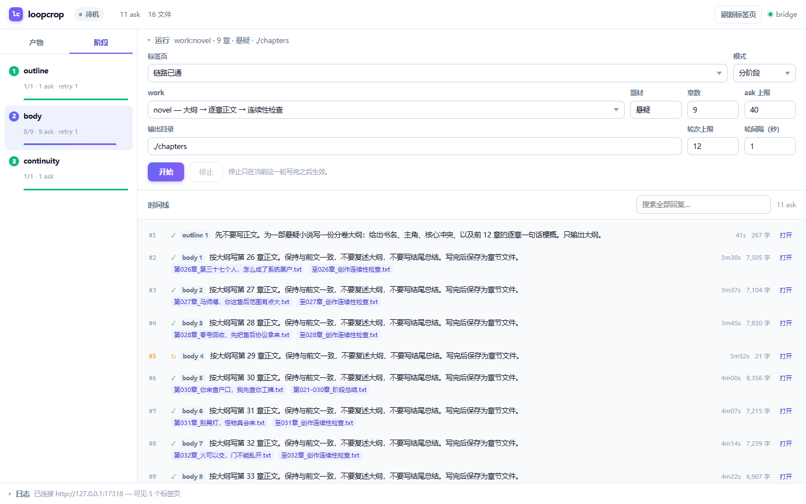

<div align="center">

# loopcrop

<a href="https://readme-typing-svg.demolab.com"></a>

**让 ChatGPT 网页版自己一轮一轮跑下去：发提示词 → 等它真正写完 → 把它生成的文件收下来 → 再发下一轮。**

不需要 API key，不另开浏览器。它驱动你已经登录的那个标签页，你现有的订阅、项目上下文、文件沙箱原样生效。

[](https://www.npmjs.com/package/loopcrop)
[](https://github.com/C0llap5ar/loopcrop/actions/workflows/ci.yml)
[](LICENSE)
[](https://github.com/C0llap5ar/loopcrop)

[English](README.md) · **简体中文**

</div>

---



<div align="center">
<sub>三栏工作台：左栏产物/阶段，中栏时间线，右栏展开任意一轮的原文。<br/>每一行都能看到这一轮跑了多久、写了多少字、卸下哪几个文件。</sub>
</div>

## 这玩意儿到底是干什么的

你有一个一次要跑几十轮的活：写一本分章的小说、批量翻译一批文档、把一堆素材整理成数据集。

在 ChatGPT 网页版里，这件事的每一步都要你手动参与：

- 每一轮它都会生成文件，你得自己点下载；
- 每一轮你都要把同一句「继续」再打一遍；
- 一轮要几分钟，你没法一直盯着；
- 页面一刷新、电脑一休眠、命名空间一断，你就不知道哪些已经保存过、哪些没有。

`loopcrop` 就是补上这个循环的工具。它把「发提示词 → 等这一轮真的结束 → 收割产物 → 再发下一轮」做成一个可中断、可续跑的循环。

小说只是内置的第一个预设。引擎本身完全不知道「小说」是什么。

## 30 秒上手：三种前端，选一个

| 你想要 | 用这个 | 代价 |
| --- | --- | --- |
| 装上就能跑，不想碰命令行 | **油猴脚本**<br/>把 `dist/loopcrop.user.js` 粘进 Tampermonkey | 文件走浏览器下载目录，路径不由你定 |
| 要断点续传、要多阶段、要精确路径 | **CLI**<br/>`npm i -g loopcrop` | 需要 Node ≥ 22 + 一个浏览器扩展桥 |
| 想看整个跑的过程、想逐条回看回复 | **GUI**<br/>`node gui/server.mjs` 然后开 `127.0.0.1:4317` | 同 CLI |

三者共用同一个内核。**断点续传和多阶段任务只有 CLI/GUI 有**——因为续跑需要磁盘上有一份 journal，浏览器里没有地方可以追加。

<details>
<summary><b>油猴脚本：四步</b></summary>

1. 装 [Tampermonkey](https://www.tampermonkey.net/) 或 Violentmonkey。
2. 把 [`dist/loopcrop.user.js`](dist/loopcrop.user.js) 的内容粘进去，新建脚本。
3. 打开一个 ChatGPT 对话页，右下角会出现控制面板。
4. 点 **Start**。

第一次运行浏览器会问「是否允许本站点多次下载」，这是浏览器策略，脚本绕不过。
</details>

<details>
<summary><b>CLI：装完就能跑</b></summary>

```bash
npm install -g loopcrop
loopcrop --help
```

CLI 不启动浏览器，它连到你已经开着的那个，通过一个扩展桥：

```
GET  /health                 -> { extensionConnected, targets: [...] }
GET  /pair                   -> { token }
WS   /ws?role=pi&token=...   { type: "request", id, method, params, target }
```

已对 [`pi-control-chrome`](https://github.com/lyd123qw2008/pi-control-chrome) 0.8.0 实测通过。任何形状相同的桥都能用——传输层只有一个文件：`cli/loop.mjs` 里的 `openTransport()`。

```bash
# 只看会发生什么，一个字都不发
loopcrop --dry-run

# 把当前这一轮的产物存下来，不发新请求
loopcrop --adopt --out ./chapters

# 跑小说预设：一轮一句「继续」
loopcrop --recipe novel --out ./chapters --turns 20

# 或者跑成分阶段任务：大纲 → 每章一次 → 连续性检查
loopcrop --work novel --chapters 12 --genre 悬疑 --out ./chapters

# 断点续传：原样再跑一遍。已完成的轮次从 journal 本地重放，绝不重发
```
</details>

<details>
<summary><b>GUI：三栏工作台</b></summary>

```bash
node gui/server.mjs          # 或 npm run gui
```

打开 `http://127.0.0.1:4317`，点「连接」探测桥并列出标签页，选好模式开跑。进度走 SSE 推送——**关掉浏览器标签页，跑批还在 Node 进程里继续**。

| 栏位 | 放什么 |
| --- | --- |
| 左栏 | **产物**（这次跑出来的文件）或**阶段**（每阶段的进度条） |
| 中栏 | 运行表单 + 时间线，每个 ask 一行 |
| 底部 | 日志，默认收起 |

时间线就是 journal 本身。每行有轮次号、检查结论（`✓` 通过、`↻` 重试、`⏸` 暂停、`✕` 中止）、属于哪个阶段第几项、花了多久、回了多少字。点一行从右侧滑出完整回复，等宽纯文本渲染——**不转 markdown**，因为产物是 `.txt`，重新排版会把正文弄乱。同一时间只开一条，60 万字的一次跑批不会把自己塞进 DOM 卡死。


觉得某轮回复不行，点「重做」会把 journal 截断到那一轮之前重跑。被截掉的轮次会重发，之前的都从磁盘重放。

```bash
PORT=4318 node gui/server.mjs     # 配置存在 .loopcrop-gui.json
```
</details>

## 它和「自动点继续」的脚本差在哪

市面上这类工具叫 auto-continue、keep-generating、自动点继续。它们大多只做一件事：每 N 秒往输入框里打一句「继续」。

|  | 自动点继续类脚本<br/>（ChatGPT Auto-Continue / Keep ChatGPT Going / 各类 Tampermonkey 续写脚本） | **loopcrop** |
|---|---|---|
| 怎么判断这一轮结束了 | 猜 DOM 状态、或者定时 | 读站点自己的消息状态 |
| 收不收产物 | ✗ 你得自己点下载 | ✓ 解析签名 URL，落真实字节 |
| 页面刷新后 | ✗ 从头乱掉 | ✓ manifest 按文件 id 去重 |
| **进程崩了之后** | ✗ 不知道发到哪了 | ✓ **journal 重放已完成的轮次，不重发、不重花配额** |
| 记不记得它回了什么 | ✗ | ✓ journal 存全文 + 内容块 + 文件清单 |
| 什么时候停 | 只能数轮数 | 标记词、正则、连续无产物、墙钟、连续失败 |
| 跨轮次的计划 | ✗ 一句「继续」到底 | ✓ 分阶段任务：大纲 → 逐项 → 复查 |
| 限速 | 固定 sleep | 带抖动的退避 + 错误预算 |

## 它到底怎么跑

分阶段任务（`--work`）是这个工具真正的形态。内置的 `novel` 预设是这样的：

| 阶段 | 来源 | 提示词 | 检查 |
|---|---|---|---|
| `outline` | 1 项 | 「写分卷大纲，不要正文」 | ≥ 200 字 |
| `body` | 每章 1 项 | 「按大纲写第 {item} 章」 | ≥ 800 字 |
| `continuity` | 1 项 | 「通读全文，列出冲突」 | ≥ 100 字 |

一次真实跑批的终端输出（`--work` + 一个只有一轮的测试 work）：

```
18:03:29 turn 1: sent
18:03:37 turn 1 settled · 0 new file(s)
[echo] item 1 · ask #1 · 10s · 5 ch · 0 file(s)
work end · done
```

这次跑完之后 `.loopcrop/journal/smoke.jsonl` 里是这样两行（一行 ask、一行标注）：

```
seq 1 | check ok | stage echo | dur 9860 ms | text "链路已通。"
```

**然后原样再跑一遍同一命令：**

```
18:04:42 resuming at turn 2
work end · done
```

一行 `sent` 都没有。它读 journal 知道第 1 轮做完了，于是什么都没发。

这不是模拟出来的结论。上面这几行来自真实浏览器 + 真实 ChatGPT 账号的实跑记录，这也是 `journal` 存在的全部理由。

## 崩了、断了、被限流了怎么办

这是 loopcrop 唯一一个别人都没有的东西，值得单独说。

每完成一次 ask，就往 `.loopcrop/journal/<run-name>.jsonl` 追加一行：提示词原文、耗时、**完整回复正文**、内容块、保存了哪些文件、检查结论、属于哪个阶段第几项第几次重试。

于是：

- **进程崩了** → 重跑同一命令，已完成的轮次在本地重放，只有没做完的会发出去。
- **页面刷新了** → 同上，而且产物文件已经按 id 去重，不会重复保存。
- **中途想改主意** → 把 journal 截断到第 K 行，从那里重跑。线性截断，不做分支树。
- **被限流了** → guard 触发，任务以 `paused` 收尾（不是 `failed`）。等一会儿，原命令再跑一遍就接上。
- **崩溃在重试预算中间** → 花掉剩下的重试，而不是重开一整轮。重试预算是**按轮计**的：`repeat: 3, retry: 1` = 三章，每章允许一次重试。

关键设计：**journal 是进度的唯一真相**，manifest 只是产物索引。恢复游标从 journal 反推，不重新计算配方——所以你在两次运行之间改了 `repeat` 或 `retry`，也不会让已经做过的轮次错位。

## 它不做什么

写清楚边界比吹功能有用，尤其是下面这几条：

- **它不是一个能让你免费用 GPT 的东西。** 它花的是你自己的订阅，和你手打这些提示词一模一样，一分不多一分不少。
- **它不绕过任何内容策略。** 模型拒绝的时候，它检查到 `noRefusal` 会暂停，不会想办法绕过去。它省的是你的鼠标和注意力，不是 OpenAI 的规则。
- **自动操作网页这件事本身违反 OpenAI 的使用条款。** 实际发生的风险通常不是封号，而是触发频率限制、或者页面结构一变适配器就失效。这个工具的设计目标就是「被限流时损失最小」——所以才有 guard、有 journal、有 `paused` 而不是 `failed`。
- **一个 run 只对一 conversations。** 中途切标签页不在模型内。
- **分阶段任务是 Node 专有功能。** 油猴包里没有 `work.js`，因为续跑需要文件系统 journal。浏览器用户拿到的是 `repeat`，不是 `--work`。
- **站点一改，适配器就坏。** ChatGPT 的 DOM 和私有接口不是公开 API。它们动了，只需要修 `core/adapters/chatgpt.js`，别的都不用动。
- **油猴脚本写不了任意路径。** 浏览器把下载交给下载管理器，文件夹是浏览器定的。要精确路径就用 CLI。
- **它现在的适配器只有 ChatGPT。** 架构上是插件式的，写一个适配器只要四个方法，但 Claude / Gemini / 各家国内模型目前都要自己写。

<details>
<summary><b>完整文档（点开）</b></summary>

### 配方（recipe）

配方是 `{ name, prompt, stop, outDir }`。`prompt` 可以是 `(turn, state)` 的函数。

```js
// my-recipe.mjs
import { anyOf, maxTurns, sawText, noArtifactsFor } from 'loopcrop/core/stops.js'

export default {
  name: 'chapter-outline',
  outDir: './outlines',
  prompt: (turn) => `为第 ${turn} 章写一份细纲，保存成 第${turn}章_细纲.txt`,
  stop: anyOf(sawText('【大纲完】'), noArtifactsFor(3), maxTurns(30)),
}
```

```bash
loopcrop --recipe ./my-recipe.mjs
```

内置：`novel`、`translate`、`repeat`、`custom`。

| 停止条件 | 什么时候触发 |
|---|---|
| `maxTurns(n)` | 完成 n 轮 |
| `sawText('全书完', 'THE END')` | 回复尾部包含某个标记 |
| `sawPattern(/第\s*\d+\s*章.*完$/)` | 正则命中回复尾部 |
| `noArtifactsFor(n)` | 连续 n 轮没有产出文件 |
| `tooManyErrors(n)` | 连续 n 次失败——站点大概在拦你 |
| `maxDuration(ms)` | 墙钟预算用完 |
| `anyOf(...)` | 任意一个先触发 |

### 分阶段任务（work）

配方是「一句话重复」。**work 是有序的阶段**，每个阶段有自己的来源、提示词、检查和重试预算。用 `--work` 代替 `--recipe`。

```js
{
  name: 'body',
  source: { dynamic: () => [...] },   // single | list | csv | jsonl | dynamic | 函数
  prompt: '按大纲写第 {item} 章',      // 支持 {item} {round} {stage} {total}，也可以是函数
  repeat: 12,                        // 每个来源项问几次
  retry: 1,                          // 检查说 retry 时多给几次
  check: { minLength: 800 },         // ok | retry | pause | abort
  done: null,                        // 可选：这个阶段提前结束的条件
}
```

`{round}` 是跨阶段的全局第几个 ask，`{item}` 是当前来源值，`{repeat}` 是本轮重复序号，`{turn}` 是轮内重试序号。

**来源的六种形态**

| 写法 | 展开成 |
|---|---|
| `{ single: value }` | 一项 |
| `{ list: [...] }` | 每个元素一项 |
| `{ csv: '文本' }` | 每行一项，按表头取键 |
| `{ jsonl: '文本' }` | 每行解析成一项 |
| `{ dynamic: () => [...] }` | 函数返回什么就是什么，可以是 promise |
| 裸字符串 / 数组 | `single` / `list` 的简写 |

**检查的四种结论**

| 结论 | 含义 |
|---|---|
| `ok` | 接受这一轮，往下走 |
| `retry` | 花掉 `stage.retry` 里的一次重试，用完就 `paused` |
| `pause` | 立刻停，已 journal 的全部保留 |
| `abort` | 停并标记为中止 |

内置检查：`minLength`、`mustMatch`、`jsonParseable`、`noRefusal`、`hasFile`、`hasBlock`，外加 `allOf` / `anyOf` 组合。任何检查都接受 `onFail: 'pause' | 'abort'` 覆盖默认的 `retry`。

**预算守卫（guards）**

守卫是预算，不是终点。它们**在两次 ask 之间**评估，所以正在跑的那一轮一定会跑完并写进 journal，然后才暂停。

```js
guards: { asks: 40, duration: 3_600_000, artifacts: 0, failures: 3, silence: 5 }
```

`asks` 数已 journal 的 ask，`duration` 是墙钟毫秒，`artifacts` 数保存的文件，`failures` 数连续发送错误，`silence` 数连续没有产出的 ask。守卫结束任务时是 `paused`，永远不是 `failed`——暂停的意思是「回头再来」，同一条命令重跑就从 journal 接上。

### 写一个适配器

适配器只有四个方法，它跑在页面里，所以能继承登录态、能调站点私有接口。

```js
{
  probe()                // -> { ok, site, conversationId, url, title }
  send(text)             // -> { ok }        把文本放进输入框并提交
  status({ sinceId })    // -> { phase: "idle" | "running" | "stalled", lastMessageId, tail, ... }
  harvest({ messageId }) // -> { text, blocks, artifacts: [{ id, name, mime, bytes, messageId, source }] }
}
```

两条不显然的规则：

1. **`status` 必须是权威的。** 靠观察 DOM「它是不是在打字」会导致重复提交，因为站点在「思考中」和「写作中」之间会闪一下 idle。优先读站点自己的消息状态。
2. **`harvest` 必须返回字节，不是链接。** 签名下载 URL 会过期、只能取一次，要在适配器里趁着会话新鲜就抓下来。

`core/adapters/chatgpt.js` 是完整范例，包括为什么它用私有会话接口而不是 DOM。更细的说明见 [`docs/writing-an-adapter.md`](docs/writing-an-adapter.md)。

### 仓库结构

```
core/
  protocol.js        adapter 契约 + 归一化
  engine.js          循环本体——唯一知道次序的文件
  journal.js         只追加的 ask 历史 + 完整回复（Node）
  session.js         幂等 ask() / 可重放时钟，由前端注入
  work.js            分阶段任务：source → prompt → check → retry，可续跑
  sources.js         single / list / csv / jsonl / dynamic 展开
  checks.js          ok / retry / pause / abort 判定
  guards.js          asks / duration / artifacts / failures / silence 预算
  stops.js           停止条件（纯谓词）
  manifest.js        崩溃安全的运行状态（Node）
  sinks.js           浏览器 sink（下载、内存）
  sinks-node.js      Node sink（文件系统、原子写、防重名）
  adapters/chatgpt.js  唯一跟站点相关的代码
  recipes/index.js   内置配方、内置 work 和解析器
cli/                 Node 前端 + 扩展桥传输层
gui/                 本地 Web 前端
userscript/          浏览器前端 + 浮动面板
scripts/             把共享内核内联成 dist/loopcrop.user.js
dist/                构建好的油猴脚本（已提交，装的时候不用构建）
docs/
  writing-an-adapter.md  加站点适配器的长版本
docs/images/         README 里用的 GUI 截图
```

仓库根还有一份 `llms.txt`：一段紧凑的纯语言说明，写清这个项目做什么、不做什么，
给那些不渲染 README 就直接摘要仓库的助手和爬虫看。

`work.js`、`sources.js`、`checks.js`、`guards.js` **故意不进油猴包**：浏览器版只带配方循环，因为分阶段任务需要文件系统 journal 才能续跑。

构建步骤是一个九十来行、零依赖的 ESM 内联器，不是打包器——模块图就十个文件，为这个装个 lockfile 太离谱。

### 测试

`npm test` 跑 59 个单测，全部用假适配器、假 journal、假传输层，所以几秒钟跑完，且只钉那些「很容易悄悄写错」的地方：轮次记账、去重、manifest 原子写、base64 字节处理、停止条件、journal 持久化、幂等重放、来源展开、检查判定、守卫预算、work 恢复游标。

那个 100 次 ask 的崩溃测试会中途中断、重开 journal、跑完，然后断言每个提示词**恰好发送一次**；manifest 丢失时会从 journal 记录重建，不会重复保存已有文件。两个 work 测试做同样的事：轮与轮之间崩了从下一轮接上而不是跳过，重试预算中间崩了花掉剩余重试而不是重开一轮。

其中三个测试覆盖 GUI 而不开浏览器：客户端用到的每个 class 必须有对应 CSS 规则，它取的每个元素 id 必须在 HTML 里存在，任何 journal 正文都不得未经转义进 `innerHTML`。最后一条重要，因为回复正文来自远端模型——当成 markup 就等于开了注入口。

真实冒烟测试在 `live/` 下，故意放在测试发现范围之外，因为它花真配额、必须永远不进 CI。

有两个单测在结构上证明不了的东西，开发时都踩过：

1. **提示词真的活着进了页面吗？** 最早的 CLI 实现对着 `send(text)` 签名调 `call('send', { text })`。页面收到 `{}`，把字面量 `[object Object]` 打进了输入框，ChatGPT 还很礼貌地问这是什么意思。而 `send()` 照样返回 `{ok: true}`——循环报告成功，实际发的是垃圾。现在 `test/cli-adapter.test.mjs` 断言提示词按位置、原样到达；把 bug 改回去会让两个测试挂掉。
2. **真收下来的文件里是真字节吗？** `npm run test:live` 往真实标签页发一句极短的提示词，再通过站点自己的接口把对话读回来，逐字符比对。花几秒配额。

发送路径还会验证点击之后输入框真的被清空了——点偏了文字还留在那儿，重试就会发两遍。

</details>

## 常见问题

**要 API key 吗？**
不要。它驱动你已登录的网页版，用的就是你的订阅。这也是它能用到项目上下文、文件沙箱、联网这些网页版专属能力的原因。

**会封号吗？**
真实的风险通常不是封号，是频率限制。你能做的：把 `pacing.between` 调大、用 `guards` 设上限、被限流时让它 `paused` 而不是硬撞。注意自动操作网页确实违反 OpenAI 的使用条款，这个风险由你判断。

**支持 Claude / Gemini / DeepSeek 吗？**
架构上是插件式的，适配器只有四个方法。但这四个方法要针对每个站点写一遍（`probe` / `send` / `status` / `harvest`），目前仓库里只有 ChatGPT 的实现。欢迎 PR。

**为什么我的油猴脚本收不到文件？**
第一次运行要让浏览器允许「本站点多次下载」，在地址栏左侧的图标里改。另外油猴版受下载管理器限制，路径由浏览器定，要精确路径请用 CLI。

**跑一半电脑睡了怎么办？**
重跑同一条命令。journal 记录了每一轮的完整结果，已完成的重放，没做完的才发出去。

**能并发跑多个吗？**
功能上可以（不同输出目录、不同对话），但同一个账号并发只会互相抢配额，收益很小。跨账号或跨站点才有意义。

**journal 会不会变得很大？**
会——它存完整回复。一次 60 万字的跑批，journal 就是 60 万字。这是有意的交换：换来「崩溃后不重发」。想清掉就从某一轮重做（会把后面截断）。

## 贡献

适配器、预设、文档都欢迎。改核心之前先跑 `npm test`，59 个测试应该全绿（含 live 之外的）。新增适配器请附一个 `live/` 下的真实冒烟脚本，别只交单测。

<a href="https://github.com/C0llap5ar/loopcrop/graphs/contributors">
  
</a>

## 许可

MIT
